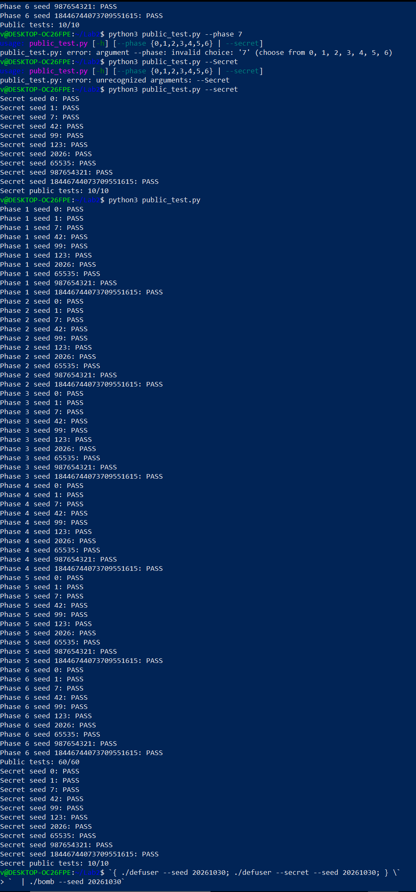
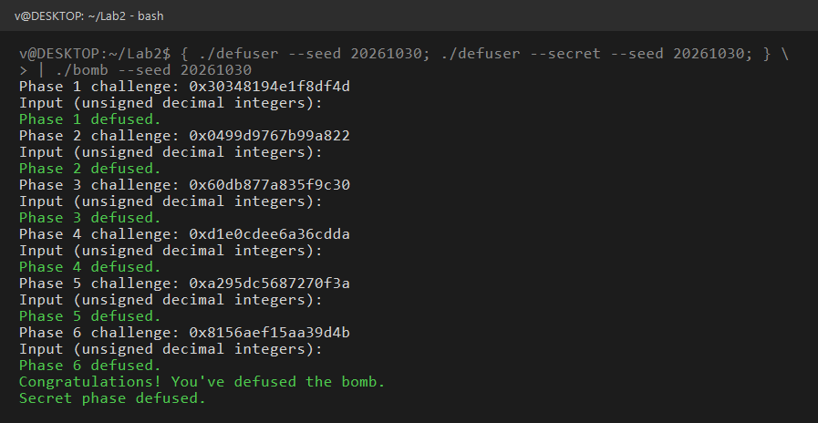

# Lab2 BombLab 实验报告

姓名 / 学号：（可填，也可留空）

## 一、实验环境与方法

- 环境：WSL2 Ubuntu，`Linux x86_64`，`gcc`、`objdump`（binutils）、`python3`。
- 每关统一流程：
  1. `objdump -d --no-show-raw-insn --disassemble=phase_0N ./bomb` 拿到本关汇编；
  2. 从 `valid_u32_fields` 的第二个参数和 `sscanf` 的格式串确定**整数个数**；
  3. 顺着调用链把 `lea / xor / shr / add` 逐条翻译成表达式，恢复出「challenge → 口令」的关系；
  4. 用 `./bomb --seed S --phase N < 口令` 单关验证，再写进 `defuser.c`；
  5. `make` 后跑 `python3 public_test.py --phase N`。
- 关键前提：每关的 `challenge` 由 `(seed, phase)` 独立生成，**同一 seed 下第 1 关和第 2 关的 challenge 不同**，所以公式必须对任意 `challenge` 成立，不能记录某次运行的具体答案。

最终结果：`Public tests: 60/60`（六关各 10/10），`Secret public tests: 10/10`。

## 二、Phase 1：函数调用与返回值

### 关键汇编

```
phase_01:
40209d: mov    $0x1,%esi
4020a2: call   valid_u32_fields       ; 第二个参数 1 → 只允许 1 个整数
4020c6: mov    $0x403189,%esi          ; 格式串 "%u"
4020db: call   p1_compute
4020e0: cmp    %eax,-0x14(%rbp)        ; 输入值 == 返回值

p1_compute:
402055: shr    $0x20,%rax              ; 高 32 位
402064: shr    $0x10,%rdx              ; ch >> 16
40206d: call   p1_step2                ; (高位, 低32)
402072: mov    %rdx,%rsi               ; 注意：step2 没写 rdx
402078: mov    %eax,%ecx
40207a: call   p1_step0                ; (低32, ch>>16, step2 结果)
40207f: mov    %ecx,%esi ; mov %eax,%edi
402083: call   p1_step1                ; (step0 结果, step2 结果)
```

三个小函数：

```
p1_step2: eax = 5*a + b ; eax ^= 0x3902
p1_step0: eax = 5*a ; esi += 0xcd4e ; eax ^= esi
p1_step1: eax = b + 0xb86 ; eax ^= a
```

### 恢复出的计算关系

令 `lo = challenge & 0xffffffff`、`hi = challenge >> 32`、`mid = (uint32_t)(challenge >> 16)`：

```
t2  = (5*hi + lo) ^ 0x3902
s0  = (5*lo) ^ (mid + 0xcd4e)
ans = (t2 + 0xb86) ^ s0
```

### 推理过程

`p1_step2` 只写了 `%eax`，没有碰 `%rdx`，所以 `402072: mov %rdx,%rsi` 是**借用这个未被破坏的寄存器**把 `ch>>16` 传给 `step0`；同理 `p1_step0` 没碰 `%ecx`，`%ecx` 里仍是 step2 的结果，于是它成了 `step1` 的第二个参数。另外 `lea (...),%eax` 和 `add $0xcd4e,%esi` 都是 32 位运算，必须按模 2³² 回绕。

### 验证记录（非公开 seed）

seed `20261030`，challenge `0x30348194e1f8df4d`，输入 `985045630` → `Phase 1 defused.`

## 三、Phase 2：数组、循环与递推

### 关键汇编

```
4020fd: mov    $0x6,%esi ; call valid_u32_fields    ; 恰好 6 个整数
40213c: lea    -0x40(%rbp),%rdx   ← v[0]
40212e: lea    -0x3c(%rbp),%rcx   ← v[1]
402148: lea    -0x38(%rbp),%r8    ← v[2]
402144: lea    -0x34(%rbp),%r9    ← v[3]
402143: push   %rax(-0x30)        ← v[4]（栈参数）
402137: push   %rax(-0x2c)        ← v[5]（栈参数）
402155: cmp    $0x6,%eax
```

六个数在 `rbp-0x40 ... rbp-0x2c` 上连续排列，步长 4，即 `int v[6]`，基址 `-0x40(%rbp)`；数组下标寻址写作 `mov -0x40(%rbp,%rdx,4),%eax`。

循环部分：

```
40216e: mov    $0x1b,%ecx        ; cl = 27，移位量
402173: mov    $0x1,%edx         ; i = 1
402178: add    %edx,%eax         ; v[i-1] + i
40217d: shr    %cl,%rdi          ; challenge >> (27 + 5*(i-1))
402183: and    $0x1f,%edi        ; 取低 5 位
402180: lea    (%rax,%rax,2),%eax ; ×3
402186: sub    %edi,%eax
402192: add    $0x1,%rdx ; 402196: add $0x5,%ecx ; 402199: cmp $0x6,%rdx
```

首项由 `shr $0x27`（39）、`movzbl %dl`（取 8 位）、`lea ×3` 得到。

### 恢复出的计算关系

```
v[0] = 3 * ((challenge >> 39) & 0xff)
v[i] = 3 * (v[i-1] + i) - ((challenge >> (27 + 5*(i-1))) & 0x1f)     i = 1..5
```

`ecx` 每次加 5，所以六项的移位量依次是 **39、27、32、37、42、47**。

### 推理过程

- `valid_u32_fields` 的第二个实参是 `0x6`，所以本关口令是 6 个整数；`-0x40(%rbp)` 到 `-0x2c(%rbp)` 地址连续、步长 4，正好 24 字节，判定为 `int v[6]`。
- 六个实参的传递方式也印证了"数组"：`v[0]~v[3]` 走 `rdx/rcx/r8/r9`（System V 的第 3~6 个整型参数），`v[4]`、`v[5]` 用 `push` 压栈，地址依次连续，说明编译器把 6 个 `&v[i]` 排成一个数组传下去。
- 循环体三条关键指令：`add %edx,%eax` 先算 `v[i-1] + i`，`lea (%rax,%rax,2),%eax` 等价于 `×3`，`sub %edi,%eax` 再减掉取出的 5 位。`shr %cl` 的 `cl` 从 `0x1b = 27` 起每轮 `+5`，所以 i = 1..5 依次对应移位量 27、32、37、42、47。
- 首项不走这个循环：`shr $0x27`（39）+ `movzbl`（取 8 位）+ `lea ×3`，即 `v[0] = 3 * ((ch >> 39) & 0xff)`。这里最容易算错的是把循环里的 27 当成首项移位量——首项是"右移 39 取 8 位"，和循环里的"右移 27 起、取低 5 位"是两套参数。
- 每项都 `and $0x1f`，值域 0..31，配合 `×3` 与减法不会溢出 32 位，因此可以直接用 `uint32_t` 递推。

### 验证记录（非公开 seed）

seed `20261030`，challenge `0x0499d9767b99a822`，输入
`534 1590 4754 14260 42770 128306` → `Phase 2 defused.`

## 四、Phase 3：switch 与跳转表

### 关键汇编

```
4022fc: mov %r12d,%edi ; and $0x7,%edi    ; v[0] = challenge & 7
402304: cmp %edi,-0x18(%rbp)
40230f: rax = ch >> 3 ; rsi = ch >> 32
402317: xor %eax,%esi                      ; x = (ch>>32) ^ (ch>>3)
402319: call p3_dispatch

p3_dispatch:
402258: cmp  $0x7,%eax
40225b: ja   4022a2                        ; 越界检查
40225d: notrack jmp *0x405820(,%rax,8)     ; 跳转表，8 项，每项 8 字节
```

表内容（`.rodata`）：

```
405820: 0x402278  0x402280  0x402288  0x402290
405840: 0x402298  0x4022a0  0x402268  0x402270
```

这些表项并不直接指向处理分支，而是指向一层 `jmp` 桩：

```
0x402268: jmp p3_case_0   0x402270: jmp p3_case_2
0x402278: jmp p3_case_4   0x402280: jmp p3_case_1
0x402288: jmp p3_case_5   0x402290: jmp p3_case_6
0x402298: jmp p3_case_3   0x4022a0: jmp p3_case_7
```

### 恢复出的计算关系

令 `sel = challenge & 7`、`x = (uint32_t)((challenge >> 32) ^ (challenge >> 3))`：

| sel | 实际分支 | 计算式 |
|---|---|---|
| 0 | case_4 | `(x ^ 0x602f) + (x >> 2)` |
| 1 | case_1 | `(2x) ^ 0xc1f4` |
| 2 | case_5 | `(4x) ^ 0xdb50` |
| 3 | case_6 | `5x + 0x12e4e` |
| 4 | case_3 | `3x + 0x5eb3` |
| 5 | case_7 | `3x + 0x7775` |
| 6 | case_0 | `(x ^ 0x9a14) + (x >> 1)` |
| 7 | case_2 | `5x + 0x544c` |

口令为 `sel` 和该计算式的值。

### 推理过程

`0x405820(,%rax,8)` 是「基址 + 8 × 下标」的间接跳转，所以下标 `sel` 直接决定表项地址；读出表项后要再跟一层 `jmp` 桩，才能落到真正的 `p3_case_N`。这套映射**不是恒等映射**（`sel=0` 对应 `case_4`），说明分支顺序被刻意打乱，必须按表逐项核对，不能凭下标猜。

### 验证记录（非公开 seed）

seed `20261030`，challenge `0x60db877a835f9c30`，输入 `0 1021063698` → `Phase 3 defused.`

## 五、Phase 4：递归

### 关键汇编

```
4023ee: mov %r12d,%edi ; and $0x7f,%edi   ; a = challenge & 0x7f
4023f1: xor %esi,%esi                     ; lo = 0
4023fe: mov $0x7f,%edx                    ; hi = 127
4023f7: shr $0x7,%rcx ; 402403: xor %eax,%ecx   ; d = (ch>>32) ^ (ch>>7)
402405: call p4_walk

p4_walk:                                  ; (a:edi, lo:esi, hi:edx, d:ecx)
402338: sub %esi,%edi ; shr $1,%edi ; add %esi,%edi   ; mid = lo + (hi-lo)/2
40233e: cmp %eax,%edi ; je 402390                     ; mid == a → 终止
402347: lea (%rdi,%rcx,1),%ebx                        ; e = mid + d
40234e: cmp %edi,%eax ; jb 402370                      ; a < mid → 左
402390: lea 0xfa(%rdi),%eax ; xor %ecx,%eax            ; (a + 0xfa) ^ d
```

### 恢复出的计算关系

```
walk(a, lo, hi, d):
    mid = lo + (hi - lo) / 2
    if mid == a:  return (mid + 0xfa) ^ d
    e = mid + d
    if a < mid:   return 3 * walk(a, lo, mid-1, d) ^ e ^ 0x1d
    else:         return 3 * walk(a, mid+1, hi, d) ^ e ^ 1
```

入口参数 `a = challenge & 0x7f`、`d = (ch>>32) ^ (ch>>7)`，初始区间 `[0, 127]`。

### 推理过程

结构是**二分查找式递归**：`mid = lo + (hi-lo)/2` 折半，与 `a` 比较后把区间收窄到 `[lo, mid-1]` 或 `[mid+1, hi]`，深度最多 7 层。返回路径上先 `lea (%rax,%rax,2)` 即 `3*r`，再异或 `e`，最后按方向异或 `0x1d`（左）或 `1`（右）——左右两个常量不同，等于把「每一步走了哪边」编码进了结果。

### 验证记录（非公开 seed）

seed `20261030`，challenge `0xd1e0cdee6a36cdda`，输入 `1916705825` → `Phase 4 defused.`

## 六、Phase 5：结构体、指针与链表

### 关键汇编

```
4024cc: lea -0x14(%rbp),%rsi     ; 第二个参数是输出指针
4024d3: call p5_traverse
4024dc: cmp %edx,-0x1c(%rbp)     ; v[0] == 返回值
4024e4: cmp %eax,-0x18(%rbp)     ; v[1] == *(&-0x14)

p5_traverse:
40242d: and $0x7,%eax
402434: mov 0x405b60(,%rax,8),%rdx   ; 按 ch & 7 选链表起点
40243f: shr $0x20,%rdi ; 402443: shr $0x6,%rax ; 402447: xor %edi,%eax
40244e: xor $0x15d4,%eax
402453: lea (%rax,%rax,2),%eax       ; 3*v
402456: add (%rdx),%eax              ; + node->value   （偏移 0）
40245b: xor %esi,%eax                ; ^ node->field4  （偏移 4）
402467: mov 0x8(%rdx),%rdx            ; node = node->next（偏移 8）
```

三个固定偏移说明节点布局：

```c
struct node { uint32_t value; uint32_t field4; struct node *next; };
```

入口表在 `0x405b60`（8 个指针），8 条链实际交汇在同一串 12 个节点上（`0x405c30` 的 `next` 为 0）。例如：

```
405c40: 4c720000 7f020000 505c4000  → value=0x724c, field4=0x27f, next=0x405c50
405c50: d7750000 3b0a0000 c05b4000  → value=0x75d7, field4=0xa3b, next=0x405bc0
```

循环变量 `ecx` 从 1 开始、每轮 `+1`，条件 `cmp %ecx,%edi ; jae`（`steps >= ecx`），所以共访问 `steps + 1` 个节点，`steps = (ch >> 3) & 3 ≤ 3`，最多 4 个。

### 恢复出的计算关系

```
v      = ((ch >> 6) ^ (ch >> 32)) ^ 0x15d4
start  = ch & 7 ,  steps = (ch >> 3) & 3
对 i = 0..steps:  v = 3*v + node[i].value ; v ^= node[i].field4
口令 = [v, node[steps].field4]
```

### 推理过程

- 调用点 `cmp %edx,-0x1c(%rbp)` 与 `cmp %eax,-0x18(%rbp)` 说明 `p5_traverse` 有两个输出：一个在 `eax`，另一个经第二参数 `-0x14(%rbp)` 写回，所以口令是 2 个数——这一点是从比较指令反推出来的，不是猜的。
- `and $0x7` 之后 `mov 0x405b60(,%rax,8),%rdx` 取指针、步长 8，说明 `0x405b60` 是一张 8 项的指针表，下标为 `ch & 7`。
- 循环体只用了三个固定偏移：`(%rdx)` 作加数、`0x4(%rdx)` 拿来异或、`0x8(%rdx)` 解引用成下一个节点，所以节点布局是 `{uint32 value; uint32 field4; node *next;}`。
- 计数由 `ecx` 决定：从 1 开始、每轮 `+1`，`cmp %ecx,%edi ; jae` 表示 `steps >= ecx` 时继续，因此共访问 `steps + 1` 个节点；`steps = (ch >> 3) & 3` 最大 3，最多 4 个节点。
- 8 个起点并不代表 8 条独立链表：8 条链共用同一串 12 个节点，终点 `0x405c30` 的 `next = 0`。若按"8 条独立链"理解，遍历长度会算错。

### 验证记录（非公开 seed）

seed `20261030`，challenge `0xa295dc5687270f3a`，输入 `2743599389 849` → `Phase 5 defused.`

## 七、Phase 6：函数指针表与间接调用

### 关键汇编

```
p6_dispatch:
40256c: shr $0x6,%rdi ; 402573: shr $0x20,%rax ; 402577: xor %eax,%edi   ; x0 = (ch>>6)^(ch>>32)
402583: and $0x7,%eax                       ; 第一次下标 = ch & 7
402580: and $0x38,%ebx                      ; 第二次下标 = (ch>>3) & 7（已乘 8）
402586: call *0x405e00(,%rax,8)             ; 第一次间接调用
40258d: xor $0xb312,%eax
402594: call *0x405e00(%rbx)                ; 第二次间接调用
40259f: add $0xfd35,%eax
```

表内容：

```
405e00: 0x402540  0x402550  0x402550  0x4024f0
405e20: 0x402550  0x402530  0x402520  0x402500
```

对应的小函数：

| 函数 | 计算式 |
|---|---|
| p6_op_0 | `(x + 0x2d2e) ^ (x >> 1)` |
| p6_op_1 | `(8x + 0xc9c2) ^ 7x` |
| p6_op_2 | `rol(x, 1) ^ 0x39b5` |
| p6_op_3 | `ror(x, 7)` |
| p6_op_4 | `(x ^ 0x8adb) + 4x` |
| p6_op_5 | `((x >> 1) ^ x) + 0x1346` |

### 恢复出的计算关系

表下标与函数的对应：`0 → op_4`、`1 → op_5`、`2 → op_5`、`3 → op_0`、`4 → op_5`、`5 → op_3`、`6 → op_2`、`7 → op_1`。

```
x0  = (ch >> 6) ^ (ch >> 32)
y   = T[ch & 7](x0) ^ 0xb312
ans = T[(ch >> 3) & 7](y) + 0xfd35
```

### 推理过程

两次间接调用的寻址写法不同：第一次 `(,%rax,8)` 用真实下标 × 8，第二次 `(%rbx)` 的 `ebx` 已被 `and $0x38` 预乘 8，两者都以 `0x405e00` 为基址。表里 8 个槽只对应 6 个函数（下标 1、2、4 都是 `op_5`），所以不能假设「8 个表项 = 8 种不同操作」。另外 `rol / ror` 是 32 位循环移位，必须用 C 的移位加或运算模拟。

### 验证记录（非公开 seed）

seed `20261030`，challenge `0x8156aef15aa39d4b`，输入 `1429514766` → `Phase 6 defused.`
整轮输出以 `Congratulations! You've defused the bomb.` 结束。

## 八、运行结果

- 公开测试：`Public tests: 60/60`（六关各 10/10），Honor 的 `Secret public tests: 10/10`。
- 非公开 seed `20261030` 的全流程输出：

```
Phase 1 challenge: 0x30348194e1f8df4d
Phase 1 defused.
Phase 2 challenge: 0x0499d9767b99a822
Phase 2 defused.
Phase 3 challenge: 0x60db877a835f9c30
Phase 3 defused.
Phase 4 challenge: 0xd1e0cdee6a36cdda
Phase 4 defused.
Phase 5 challenge: 0xa295dc5687270f3a
Phase 5 defused.
Phase 6 challenge: 0x8156aef15aa39d4b
Phase 6 defused.
Congratulations! You've defused the bomb.
Secret phase defused.
```





截图文件放在仓库的 `images/` 目录下，命名与上面两行一致，随代码一起提交。

## 九、Honor（secret）部分

### 9.1 入口：第七行从哪来，`context` 是什么

`main` 在六关全部通过后做四件事：

```
4015b7: lea    rcx,[rbp-0x630]          ; 第 2 关答句缓冲区
4015de: punpcklqdq xmm0,xmm1            ; 把 6 个答句缓冲区地址拼成 char*[6]
40162f: call   transcript_context       ; context = 六行答句的数字摘要
401634: mov    esi,0x7
401643: call   phase_challenge          ; challenge = challenge_from_seed(seed, 7)
401648: mov    rdx,rbx                  ; 第 3 参数 = context
401652: mov    rsi,rax                  ; 第 2 参数 = challenge
401655: call   secret_gate              ; secret_gate(第七行, challenge, context)
40165d: test   al,al
40165f: je     explode_bomb             ; 返回 0 就 BOOM
```

由此确定：`solve_secret(challenge, context, ...)` 的 `context` 就是驱动里 `transcript_context(前六行)` 的值（每行按十进制数字切分、逐个 `context_mix` 折叠），`challenge` 是 phase 7 的 challenge。两者都要参与运算，任何一个都不能当常量。

### 9.2 secret_gate：格式门槛（关键汇编）

```
40272b: lea    r12,[rbp-0xd0]           ; 缓冲区起点
402740: rep stos QWORD PTR [rdi],rax    ; 20 个 qword + 1 个 dword 清零（164 字节）
40274c: call   strlen@plt
402751: sub    rax,0x24                 ; len - 36
402755: cmp    rax,0x7f
402759: jbe    402770                   ; 无符号比较：只接受 36 ≤ len ≤ 163
402776: call   secret_copy              ; 逐字节拷贝整行（含结尾 NUL）
40277b: cmp    DWORD PTR [rbp-0xb0],0x4e45504f   ; 缓冲区 + 0x20 处 == "OPEN"
402785: jne    40275b                   ; 否则返回 0
402794: call   secret_phase              ; 参数是 缓冲区 + 0x24
```

`0x4e45504f` 按小端就是 `"OPEN"`，但比较的地址是 `[rbp-0xb0]`、缓冲区基址是 `[rbp-0xd0]`，两者相差 `0x20`，也就是说 **`"OPEN"` 必须在整行的第 32~35 字节**，不是行首；`secret_phase` 的字符串参数又是 `[rbp-0xac]`，即第 36 字节。我第一次按"行首 OPEN"拼行，`bomb` 走到 `Congratulations!` 之后仍然 BOOM；把 `"OPEN"` 挪到偏移 32 后立刻通过。这是本题最容易踩的坑——三个偏移 0x20 / 0x24 / 0xd0 必须一起看。

### 9.3 secret_phase：三个 u32 的关系（关键汇编）

```
40264f: call valid_u32_fields(str,3)    ; 恰好 3 个十进制 u32（超出 32 位或有多余字符都拒绝）
402686: call __isoc99_sscanf(str,"%u %u %u", &a,&b,&c)
402690: mov ecx,r13d ; and ecx,0x3      ; r13 = context
402698: cmp [rbp-0x2c],ecx              ; a == context & 3
4026b2: xor esi,r12d                    ; A = (challenge>>32) ^ (challenge & 0xffffffff)
4026b5: xor r8d,r13d                    ; B = (context>>32)  ^ (context  & 0xffffffff)
4026b8: shr r13,0x10                    ; context >> 16
4026be: xor r9d,r13d                    ; C = (context&3)*0x5a1f ^ (context>>16 的低 32 位)
4026c1: xor edi,r8d ; call secret_mix   ; mix32(A ^ B)
4026c9: xor eax,r9d ; cmp [rbp-0x28],eax ; b == mix32(A^B) ^ C
4026d1: shr esi,0x7                     ; A >> 7
4026d4: lea edx,[r8+rcx*1+0xa916]       ; B + (context&3) + 0xa916
4026dc: add edx,esi
4026de: xor eax,edx ; cmp [rbp-0x24],eax ; c == b ^ edx
4026e3: sete dl                         ; 三个比较全过才返回 1

secret_mix: rol eax,0x7 ; add eax,0x5a1f ; xor eax,0xa916
```

恢复出的关系（全部是 32 位运算，加法与移位都按 $2^{32}$ 回绕）：

```
A = (challenge >> 32) ^ (challenge & 0xffffffff)
B = (context   >> 32) ^ (context   & 0xffffffff)
mix32(v) = (rol32(v, 7) + 0x5a1f) ^ 0xa916

a = context & 3
b = mix32(A ^ B) ^ ( (context & 3) * 0x5a1f ^ (context >> 16 的低 32 位) )
c = b ^ ( (A >> 7) + B + (context & 3) + 0xa916 )
```

几个细节：

- `r12` 是 challenge、`r13` 是 context，来自调用点 `mov rsi,rax` / `mov rdx,rbx` 的顺序，不能想当然交换。
- `xor r8d,r13d` 只改 `r8` 的低 32 位，但 `r8` 原本就是 `context >> 32`（高位为零），所以后面 `lea edx,[r8+rcx*1+0xa916]` 取到的仍是 `B`，而不是 `(context>>32)` 原值——这里我一开始把 `lea` 的基址当成 `context>>32`，算出的 `c` 偏了，用非公开 seed 交叉验证时才发现。
- `rol` 是 32 位循环移位，必须写成 `(v << 7) | (v >> 25)`，不能用普通左移。

### 9.4 输出行的构造

`solve_secret` 输出一行：前 32 字节填充（这里用空格）+ `"OPEN"` + 空格 + 三个十进制 u32。行长 36 + 数字部分，落在 `[36, 163]` 内，`valid_u32_fields` 与 `sscanf` 都能通过。

### 9.5 验证记录（非公开 seed 之外）

| seed | 结果 |
| --- | --- |
| 777 | `Secret phase defused.` |
| 123456789 | `Secret phase defused.` |
| 20261030 | `Secret phase defused.` |
| 4294967296 | `Secret phase defused.` |
| 31415926535 | `Secret phase defused.` |

其中 `4294967296`（即 $2^{32}$）专门用来验证高低 32 位拆分：低 32 位为 0、高 32 位为 1，如果公式把 `challenge`/`context` 的整体当成 32 位就会在这里露馅。

`python3 public_test.py --secret` 的结果为 `Secret public tests: 10/10`；全量 `python3 public_test.py` 为 `Public tests: 60/60`、`Secret public tests: 10/10`。

### 9.6 随机 seed 抽查

公开列表只有 10 个 seed，为了确认公式对任意 `(challenge, context)` 都成立（而不是记下了某几次的答案），又用 `random.getrandbits(64)` 现场生成 20 个 64 位 seed，直接调用 `public_test.py` 里的 `check_seed`（流程：`defuser --seed S` 出六行 → 喂 `bomb` 校验 → `defuser --secret --seed S` → 六行加 secret 行再喂 `bomb` → 要求输出里出现 `Secret phase defused.`）。结果 **20/20 PASS**，其中几条：

| seed | 结果 |
| --- | --- |
| 4053719590916208210 | PASS |
| 7596897423412270899 | PASS |
| 13537106793910617173 | PASS |
| 12142126885077550053 | PASS |
| 17068187748191050918 | PASS |

因为 `context` 是由喂给 `bomb` 的那六行文本折叠出来的，这 20 次 PASS 同时说明六关的答句与 secret 行是一条完整、彼此自洽的链路，任何一环写死都会在这里断掉。

## 十、参考与工具

- 题目与规则来源：课程主页 <https://ics-26fall-fdu.github.io/>，以及仓库 `README.md`（提交物、Secret 说明、报告要求与评分规则）。
- 课程提供的 `teaching/` 目录（`01_abi.c` 到 `07_stack_copy.c`）与 `tutor` 参考实现，用于对照各关考察点（参数传递、数组、跳转表、递归、结构体、函数指针）。
- 工具：`objdump -d/-s`（反汇编与 `.rodata` 转储，用于取格式串、跳转表、入口表和节点数据）、`readelf -S` 与 `strings`（定位段偏移与字符串地址）、`python3`（复算公式并与 `bomb` 交叉验证）。
- 本机 WSL 未安装 `gdb`，寄存器与内存内容全部通过 `objdump` 静态推算，再用 `bomb` 的反馈做黑盒验证（公式错会直接 `BOOM`），因此报告中没有单步调试记录。
- 使用 AI 助手辅助阅读汇编、核对运算宽度与整理本报告结构；所有公式均在本地用 `bomb` 对非公开 seed 实际验证通过后才写入 `defuser.c`。
